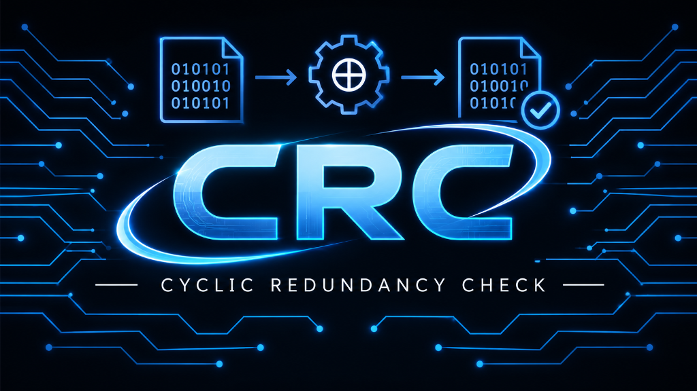

# CRC Code Simulator


<br>
=======


<div align="center">
  
</div>


<br>
=======


A professional educational tool for understanding Cyclic Redundancy Check (CRC) error detection algorithms. This simulator provides both a graphical interface and command-line tools for exploring how CRC works in data transmission.


## Features

- **Professional GUI Application**: User-friendly tkinter-based interface for interactive CRC simulation
- **Multiple CRC Polynomials**: Support for CRC-3, CRC-4, CRC-8, and CRC-16
- **Comprehensive Testing Modes**:
  - Custom data input with error simulation
  - Random data generation with configurable errors
  - Burst error detection testing
  - Polynomial comparison for different scenarios
- **Step-by-Step Visualization**: Traditional long division format showing the CRC calculation process
- **Command-Line Interface**: Demo scripts for automated testing and demonstration
- **Standalone Executable**: Pre-built Windows executable included (no Python installation required)

## How It Works

### CRC Algorithm Overview

Cyclic Redundancy Check (CRC) is an error-detecting code used to detect accidental changes to raw data. The algorithm works as follows:

1. **Data Preparation**: The original binary data has zeros appended to it (number of zeros = polynomial degree - 1)
2. **Modulo-2 Division**: The extended data is divided by the generator polynomial using binary XOR operations
3. **Remainder Calculation**: The remainder from this division becomes the CRC checksum
4. **Transmission**: The original data + CRC checksum is transmitted
5. **Verification**: The receiver performs the same division - if the remainder is zero, the data is valid

### Project Architecture

The project is organized into three main components:

1. **Core Logic (`src/crc_simulator.py`)**: Contains the `CRCSimulator` class that implements all CRC operations
2. **GUI Interface (`src/crc_gui.py`)**: Provides a professional tkinter-based graphical interface
3. **Interactive CLI (`src/interactive_crc.py`)**: Offers a command-line interactive mode for users

## Screenshots

*(Add screenshots of your GUI here)*

## Installation

### Option 1: Using the Standalone Executable (Windows)

1. Download `CRC_CodeSimulator/CRC_Simulator.exe`
2. Double-click to run the application
3. No additional installation required

### Option 2: Running from Source

**Prerequisites:**
- Python 3.6 or higher
- No external dependencies required (uses only Python standard library)

**Steps:**

1. Clone or download this repository:
```bash
git clone <repository-url>
cd "Cyclic Redundancy Check (CRC) Code Simulator/CRC_CodeSimulator"
```

2. Run the GUI:
```bash
# Windows
run_gui.bat

# Or using Python directly
python launch_gui.py
```

### Option 3: Building from Source

To create your own standalone executable:

```bash
# Install PyInstaller (optional)
pip install pyinstaller

# Build the executable
pyinstaller CRC_Simulator.spec
```

## Usage

### Using the GUI

The GUI provides six main tabs:

#### 1. CRC Overview Tab
- Educational content explaining what CRC is
- How CRC works step by step
- Generator polynomials and their applications
- Error detection capabilities
- Limitations of CRC
- Example calculation walkthrough

#### 2. Custom Data Tab
- Enter your own binary data (e.g., "1011001")
- Specify error positions to simulate transmission errors
- Select a generator polynomial
- Click "RUN_SIMULATION" to see the detailed calculation process

#### 3. Random Data Tab
- Generate random test data with configurable length
- Specify the number of random bit errors to introduce
- Test different polynomials with random scenarios

#### 4. Burst Error Tab
- Test consecutive bit error detection
- Specify burst error length
- Verify detection capability of different polynomials

#### 5. Polynomial Comparison Tab
- Compare error detection capabilities of different CRC polynomials
- Test the same data with multiple polynomials simultaneously
- Understand which polynomial offers better detection for your use case

#### 6. All Scenarios Tab
- Run comprehensive demonstration of all predefined test scenarios
- Includes error-free transmission, single/multiple bit errors, and burst errors

### Using the Command-Line Interface

Run the comprehensive demo:

```bash
python run_demo.py
```

This will demonstrate:
- Error-free transmission with CRC-3
- Single bit error detection
- Multiple bit errors detection
- Burst error detection
- Different polynomial comparisons (CRC-3, CRC-4, CRC-8)

#### Interactive CLI Mode

For an interactive command-line experience:

```bash
python src/interactive_crc.py
```

This provides a menu-driven interface with 6 options:
1. Calculate CRC for custom data
2. Verify data with CRC
3. Demonstrate transmission with errors
4. Test burst error detection
5. Compare different polynomials
6. Exit

### Using as a Python Library

```python
from src.crc_simulator import CRCSimulator

# Initialize with CRC-4 polynomial
simulator = CRCSimulator(polynomial="10011")

# Calculate CRC
data = "1011001"
data_with_crc, checksum = simulator.calculate_crc(data)
print(f"CRC Checksum: {checksum}")

# Verify received data
is_valid, remainder = simulator.verify_crc(data_with_crc)
print(f"Valid: {is_valid}")

# Demonstrate transmission with errors
result = simulator.demonstrate_transmission("1011001", error_positions=[2], show_steps=True)
for step in result['steps']:
    print(step)
```

## Documentation

Detailed documentation is available in the `docs/` folder:

- **[User Guide](CRC_CodeSimulator/docs/user_guide.md)**: Comprehensive guide for using the GUI and understanding CRC
- **[API Reference](CRC_CodeSimulator/docs/api_reference.md)**: Complete API documentation for the CRCSimulator class
- **[CRC Code Simulator Main PDF](CRC_CodeSimulator/docs/CRC_Code_Simulator_main.pdf)**: Detailed project documentation

## Project Structure

```
CRC_CodeSimulator/
├── CRC_Simulator.exe          # Standalone Windows executable (built with PyInstaller)
├── launch_gui.py              # GUI launch script - imports and runs the GUI
├── run_demo.py                # Command-line demo script - runs comprehensive demonstration
├── run_gui.bat                # Windows batch file for quick GUI launch
├── requirements.txt           # Python dependencies (no external deps required)
├── CRC_Simulator.spec         # PyInstaller specification file for building executable
├── src/
│   ├── crc_simulator.py       # Core CRC simulation logic - CRCSimulator class
│   ├── crc_gui.py             # GUI implementation - CompleteCRCGUI class
│   └── interactive_crc.py     # Interactive CLI mode - command-line interface
├── docs/
│   ├── user_guide.md          # User documentation - how to use the GUI
│   ├── api_reference.md       # API documentation - CRCSimulator class reference
│   └── CRC_Code_Simulator_main.pdf  # Detailed project documentation (PDF)
├── tests/                     # Unit tests for all components
│   ├── test_crc_simulator.py  # Tests for core CRC logic
│   ├── test_crc_gui.py        # Tests for GUI components
│   └── test_interactive.py    # Tests for interactive CLI
├── build/                     # Build artifacts from PyInstaller
└── Project/                   # Additional project files and documentation
    ├── PROJECT_STRUCTURE.md   # Detailed project structure documentation
    ├── README.md              # Project-specific README
    ├── SETUP_GUIDE.md         # Setup and installation guide
    └── Project GuideLines.pdf # Project guidelines document
```

## File Descriptions

### Root Level Files

#### `CRC_Simulator.exe`
- **Purpose**: Standalone Windows executable for users without Python installation
- **Built With**: PyInstaller (see `CRC_Simulator.spec`)
- **Usage**: Double-click to run the GUI application
- **Dependencies**: None (includes all dependencies)

#### `launch_gui.py`
- **Purpose**: Script to launch the GUI application
- **How It Works**:
  1. Adds the `src` directory to Python path
  2. Imports the `main()` function from `crc_gui.py`
  3. Executes the GUI application
- **Usage**: `python launch_gui.py`
- **Dependencies**: `tkinter` (Python standard library)

#### `run_demo.py`
- **Purpose**: Command-line demonstration script showing all CRC scenarios
- **How It Works**:
  1. Imports `CRCSimulator` from `src/crc_simulator.py`
  2. Runs 7 comprehensive scenarios:
     - Error-free transmission (CRC-3)
     - Single bit error detection (CRC-3)
     - Multiple bit errors detection (CRC-3)
     - Burst error detection (CRC-3)
     - Different polynomial demonstration (CRC-4)
     - CRC-8 demonstration
     - Polynomial comparison
  3. Each scenario uses `show_steps=True` for detailed output
- **Usage**: `python run_demo.py`
- **Output**: Detailed step-by-step output for each scenario

#### `run_gui.bat`
- **Purpose**: Windows batch file for quick GUI launch
- **How It Works**: Calls `python launch_gui.py`
- **Usage**: Double-click or run from command line
- **Platform**: Windows only

#### `requirements.txt`
- **Purpose**: Python dependencies specification
- **Contents**: No external dependencies required - uses only Python standard library
- **Optional Dependencies** (commented):
  - `pytest>=7.0.0` - For running unit tests
  - `pyinstaller>=5.0.0` - For building standalone executables

#### `CRC_Simulator.spec`
- **Purpose**: PyInstaller specification file for building the executable
- **Configuration**:
  - Entry point: `src/crc_gui.py`
  - Console mode: Disabled (GUI application)
  - Output name: `CRC_Simulator.exe`
  - UPX compression: Enabled
- **Usage**: `pyinstaller CRC_Simulator.spec`
- **Result**: Creates standalone executable in `dist/` folder

### Source Files (`src/`)

#### `src/crc_simulator.py`
- **Purpose**: Core CRC simulation logic - the heart of the application
- **Main Class**: `CRCSimulator`
- **Key Methods**:
  - `__init__(polynomial)`: Initialize with generator polynomial
  - `xor_operation(a, b)`: Perform XOR on two binary strings
  - `mod2_division(data, polynomial, show_steps)`: Perform modulo-2 binary division
  - `calculate_crc(data, show_steps)`: Calculate CRC checksum
  - `verify_crc(received_data, show_steps)`: Verify data integrity
  - `introduce_error(data, error_positions)`: Flip bits at specified positions
  - `demonstrate_transmission(data, error_positions, show_steps)`: Full transmission demo
  - `burst_error_detection(data, burst_length)`: Test burst error detection
- **How It Works**:
  1. Uses polynomial degree to determine number of zeros to append
  2. Performs XOR-based binary division (no carries, no borrows)
  3. Generates step-by-step long division format when `show_steps=True`
  4. Returns remainder which becomes the CRC checksum
- **Supported Polynomials**:
  - CRC-3: `"1101"` (degree 3)
  - CRC-4: `"10011"` (degree 4)
  - CRC-8: `"100000111"` (degree 8)
  - CRC-16: `"10001000000100001"` (degree 16)
- **Usage Example**:
  ```python
  from src.crc_simulator import CRCSimulator
  simulator = CRCSimulator(polynomial="10011")
  data_with_crc, checksum = simulator.calculate_crc("1011001")
  ```

#### `src/crc_gui.py`
- **Purpose**: Professional GUI application using tkinter
- **Main Class**: `CompleteCRCGUI`
- **Key Features**:
  - Modern light blue theme matching professional design
  - Six tabs for different testing modes
  - Real-time results display
  - Step-by-step visualization in long division format
- **How It Works**:
  1. **Initialization**: Sets up tkinter window with 1600x900 resolution
  2. **Styling**: Uses ttk.Style for professional appearance
  3. **Layout**: Two-column design (tabs on left, results on right)
  4. **Tab Creation**: Creates 6 functional tabs
- **Tabs**:
  1. **CRC_OVERVIEW**: Educational content explaining CRC
  2. **CUSTOM_DATA**: Test your own binary data with custom errors
  3. **RANDOM_DATA**: Generate random test data with configurable errors
  4. **BURST_ERROR**: Test consecutive bit error detection
  5. **POLYNOMIAL_TEST**: Compare different polynomials on same data
  6. **ALL_SCENARIOS**: Run comprehensive demonstration of all test cases
- **Key Methods**:
  - `setup_styles()`: Configure professional styling
  - `create_main_interface()`: Build main layout
  - `create_crc_overview_tab()`: Educational content tab
  - `create_custom_data_tab()`: Custom data testing
  - `create_random_data_tab()`: Random data generation
  - `create_burst_error_tab()`: Burst error testing
  - `create_polynomial_test_tab()`: Polynomial comparison
  - `create_all_scenarios_tab()`: All scenarios demo
  - `run_custom_simulation()`: Execute custom data simulation
  - `run_random_test()`: Execute random data test
  - `run_burst_test()`: Execute burst error test
  - `run_polynomial_comparison()`: Compare polynomials
  - `run_all_scenarios()`: Run all predefined scenarios
  - `update_poly()`: Update generator polynomial
  - `display_results()`: Show simulation results
- **Dependencies**: `tkinter`, `ttk`, `crc_simulator.py`, `random`

#### `src/interactive_crc.py`
- **Purpose**: Interactive command-line interface for CRC operations
- **Key Functions**:
  - `print_menu()`: Display main menu with 6 options
  - `get_binary_input(prompt)`: Validate and get binary input from user
  - `get_polynomial_choice()`: Get polynomial selection from user
  - `calculate_crc_mode()`: Mode 1 - Calculate CRC for custom data
  - `verify_crc_mode()`: Mode 2 - Verify data with CRC
  - `transmission_mode()`: Mode 3 - Demonstrate transmission with errors
  - `burst_error_mode()`: Mode 4 - Test burst error detection
  - `compare_polynomials_mode()`: Mode 5 - Compare different polynomials
  - `main()`: Main interactive loop
- **How It Works**:
  1. Displays menu with 6 options
  2. User selects operation mode
  3. Prompts for required inputs (data, polynomial, errors)
  4. Calls appropriate `CRCSimulator` methods
  5. Displays results with step-by-step output
- **Usage**: `python src/interactive_crc.py`
- **Menu Options**:
  1. Calculate CRC for custom data
  2. Verify data with CRC
  3. Demonstrate transmission with errors
  4. Test burst error detection
  5. Compare different polynomials
  6. Exit

### Test Files (`tests/`)

#### `tests/test_crc_simulator.py`
- **Purpose**: Unit tests for core CRC logic
- **Test Functions**:
  - `test_initialization()`: Verify simulator initializes correctly
  - `test_xor_operation()`: Test XOR operation
  - `test_crc_calculation()`: Test CRC calculation
  - `test_crc_verification()`: Test CRC verification (valid and corrupted data)
  - `test_error_introduction()`: Test error introduction
  - `test_transmission_demo()`: Test transmission demonstration
  - `test_burst_error_detection()`: Test burst error detection
  - `test_different_polynomials()`: Test all supported polynomials
- **Usage**: `python tests/test_crc_simulator.py` or `pytest tests/test_crc_simulator.py`

#### `tests/test_crc_gui.py`
- **Purpose**: Unit tests for GUI components
- **Test Functions**:
  - `test_gui_initialization()`: Verify GUI initializes correctly
  - `test_polynomial_update()`: Test polynomial update functionality
  - `test_field_clearing()`: Test field clearing functionality
- **Usage**: `python tests/test_crc_gui.py` or `pytest tests/test_crc_gui.py`

#### `tests/test_interactive.py`
- **Purpose**: Unit tests for interactive CLI
- **Test Functions**:
  - `test_binary_input_validation()`: Test binary input validation
  - `test_polynomial_choice()`: Test polynomial selection
  - `test_menu_display()`: Test menu display
- **Usage**: `python tests/test_interactive.py` or `pytest tests/test_interactive.py`

### Documentation Files (`docs/`)

#### `docs/user_guide.md`
- **Purpose**: Comprehensive user guide for the GUI application
- **Contents**:
  - Introduction to CRC
  - Getting started instructions
  - Detailed usage of each tab
  - Understanding CRC concepts
  - Advanced features
  - Troubleshooting guide

#### `docs/api_reference.md`
- **Purpose**: Complete API documentation for `CRCSimulator` class
- **Contents**:
  - Constructor documentation
  - Method signatures and parameters
  - Return values
  - Usage examples
  - Error handling
  - Performance considerations

#### `docs/CRC_Code_Simulator_main.pdf`
- **Purpose**: Detailed project documentation in PDF format
- **Contents**: Comprehensive project documentation

### Project Folder (`Project/`)

#### `Project/PROJECT_STRUCTURE.md`
- **Purpose**: Detailed technical documentation of project structure
- **Contents**: In-depth explanation of each file and folder

#### `Project/README.md`
- **Purpose**: Project-specific README for development context
- **Contents**: Additional project details and guidelines

#### `Project/SETUP_GUIDE.md`
- **Purpose**: Setup and installation guide
- **Contents**: Step-by-step installation instructions

#### `Project/Project GuideLines.pdf`
- **Purpose**: Project guidelines document
- **Contents**: Development guidelines and standards

### Build Folder (`build/`)

- **Purpose**: Contains build artifacts from PyInstaller
- **Contents**: Intermediate build files (can be deleted after executable is created)

## How the Project Works

### Data Flow

1. **User Input** → GUI or CLI accepts binary data and parameters
2. **CRCSimulator** → Core logic processes the data
3. **Calculation** → Modulo-2 division produces remainder (CRC)
4. **Transmission** → Data + CRC is "transmitted" (with optional errors)
5. **Verification** → Receiver checks if remainder is zero
6. **Output** → Results displayed with step-by-step visualization

### Execution Paths

#### GUI Mode (Primary)
```
User launches launch_gui.py
    ↓
GUI window opens (CompleteCRCGUI)
    ↓
User selects tab and enters data
    ↓
User clicks RUN button
    ↓
GUI calls CRCSimulator methods
    ↓
Results displayed in right panel
```

#### Demo Mode
```
User runs run_demo.py
    ↓
Script creates CRCSimulator instances
    ↓
Runs 7 predefined scenarios
    ↓
Outputs step-by-step results to console
```

#### Interactive CLI Mode
```
User runs interactive_crc.py
    ↓
Menu displayed with 6 options
    ↓
User selects operation
    ↓
Script prompts for inputs
    ↓
CRCSimulator processes and displays results
    ↓
Loop continues until user exits
```

#### Library Mode
```
Developer imports CRCSimulator
    ↓
Creates instance with polynomial
    ↓
Calls methods: calculate_crc(), verify_crc(), etc.
    ↓
Uses results in their application
```

### Key Algorithms

#### Modulo-2 Division
The core CRC algorithm uses XOR-based binary division:
- No carries or borrows (unlike regular division)
- Each bit is processed independently
- If leading bit is 1, XOR with polynomial
- If leading bit is 0, XOR with zeros
- Continue until all bits processed
- Final remainder is the CRC

#### Long Division Format
When `show_steps=True`, the algorithm generates traditional long division:
```
    Dividend with appended zeros
Polynomial)Quotient
    ────────────
    Divisor (if leading bit is 1)
    ────────────
    XOR result with next bit
    ────────────
    Continue...
    ────────────
    Remainder (CRC)
```

This format helps users understand the mathematical process.

## Development Guide

### Running Tests

The project includes comprehensive unit tests for all components:

```bash
# Run all simulator tests
python tests/test_crc_simulator.py

# Run all GUI tests
python tests/test_crc_gui.py

# Run all interactive tests
python tests/test_interactive.py

# Or use pytest (if installed)
pytest tests/
```

### Building the Executable

To create a standalone Windows executable:

```bash
# Install PyInstaller (if not already installed)
pip install pyinstaller

# Build the executable
pyinstaller CRC_Simulator.spec

# The executable will be in: dist/CRC_Simulator.exe
```

The `CRC_Simulator.spec` file configures:
- Entry point: `src/crc_gui.py`
- Console mode: Disabled (GUI application)
- Output name: `CRC_Simulator.exe`
- UPX compression: Enabled for smaller file size

### Adding New Features

#### Adding a New CRC Polynomial
1. Add the polynomial to the dropdown lists in `crc_gui.py`
2. Update the polynomial choice menu in `interactive_crc.py`
3. Add to documentation

#### Adding a New Test Scenario
1. Add scenario function in `run_demo.py`
2. Add corresponding GUI tab in `crc_gui.py`
3. Add unit tests in `tests/`

#### Extending the GUI
1. Add new tab method in `CompleteCRCGUI` class
2. Create input fields using `create_input_field()`
3. Add button to trigger simulation
4. Display results using `display_results()`

## Technical Details

### CRC Polynomial Standards

The project uses standard CRC polynomials:

| Polynomial | Binary | Degree | Common Name | Use Case |
|------------|--------|--------|-------------|----------|
| CRC-3 | 1101 | 3 | - | Simple demonstrations |
| CRC-4 | 10011 | 4 | ITU-T G.704 | Telecom protocols |
| CRC-8 | 100000111 | 8 | CRC-8-CCITT | Embedded systems |
| CRC-16 | 10001000000100001 | 16 | CRC-16-CCITT | USB, Modbus |

### Error Detection Capabilities

CRC can detect:
- **Single-bit errors**: Always detected (100%)
- **Double-bit errors**: Always detected (100%)
- **Odd number of bit errors**: Always detected (100%)
- **Burst errors**: Detected if burst length ≤ polynomial degree
- **Longer burst errors**: High probability (>99%)

### Limitations

CRC cannot:
- Correct errors (only detect them)
- Detect all possible error patterns
- Detect malicious changes (use cryptographic hashes instead)
- Detect certain rare error combinations that produce valid checksums

### Performance Characteristics

- **Time Complexity**: O(n) where n is data length
- **Space Complexity**: O(n) for storing data and results
- **Recommended Data Size**: 8-64 bits for educational use
- **Maximum Data Size**: Limited by system memory (tested up to 1000 bits)

## Troubleshooting

### Common Issues

**GUI won't start**
- Ensure Python 3.6+ is installed
- Verify tkinter is available (included with Python on Windows/macOS)
- On Linux: `sudo apt-get install python3-tk`

**Import errors**
- Make sure you're in the `CRC_CodeSimulator` directory
- Try adding `src/` to Python path: `export PYTHONPATH="${PYTHONPATH}:./src"`

**Tests failing**
- Ensure all files are in correct locations
- Check Python version compatibility
- Verify no file name conflicts

**Build errors with PyInstaller**
- Update PyInstaller: `pip install --upgrade pyinstaller`
- Check Python architecture (32-bit vs 64-bit)
- Try building without UPX: Remove `upx=True` from spec file

### Getting Help

- Check `docs/user_guide.md` for GUI usage
- Review `docs/api_reference.md` for API details
- See `Project/SETUP_GUIDE.md` for installation issues
- Run tests to verify installation: `python tests/test_crc_simulator.py`

## Git Repository Information

This project uses Git for version control. The repository includes:

- `.git/`: Git configuration and history
- `.gitattributes`: Git attributes for file handling

### Git Workflow

```bash
# Clone the repository
git clone <repository-url>
cd "Cyclic Redundancy Check (CRC) Code Simulator"

# Check status
git status

# View changes
git diff

# Commit changes
git add .
git commit -m "Description of changes"

# View history
git log
```

## License

This project is licensed under the MIT License - see the LICENSE file for details.

## Acknowledgments

- Educational tool for computer networking and data communications courses
- Based on standard CRC algorithms used in industry
- Designed for clarity and educational value
- Uses Python's tkinter for cross-platform GUI support

## Author

Kushagra

## Support

For issues, questions, or suggestions:
- Open an issue on GitHub
- Check the [User Guide](CRC_CodeSimulator/docs/user_guide.md) for common troubleshooting
- Review the [API Reference](CRC_CodeSimulator/docs/api_reference.md) for technical details
- See [Project/SETUP_GUIDE.md](CRC_CodeSimulator/Project/SETUP_GUIDE.md) for installation help

## Quick Reference

### Running the Application

```bash
# GUI (Windows)
run_gui.bat

# GUI (Mac/Linux/Windows)
python launch_gui.py

# Standalone executable (Windows)
CRC_Simulator.exe

# Demo script
python run_demo.py

# Interactive CLI
python src/interactive_crc.py
```

### Testing

```bash
# Run all tests
python tests/test_crc_simulator.py
python tests/test_crc_gui.py
python tests/test_interactive.py

# Or with pytest
pytest tests/
```

### Building

```bash
# Build executable
pyinstaller CRC_Simulator.spec
```

### File Locations

- **Core Logic**: `src/crc_simulator.py`
- **GUI**: `src/crc_gui.py`
- **CLI**: `src/interactive_crc.py`
- **Tests**: `tests/`
- **Documentation**: `docs/`
- **Executable**: `CRC_Simulator.exe`
